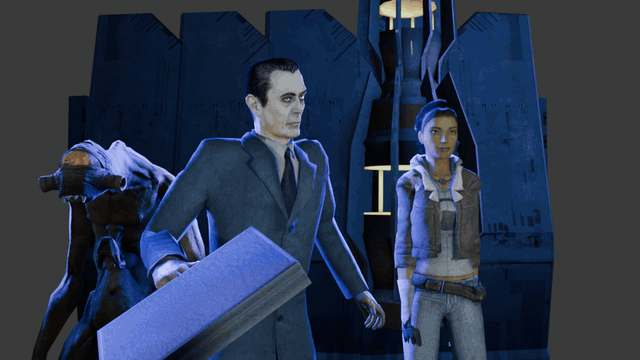
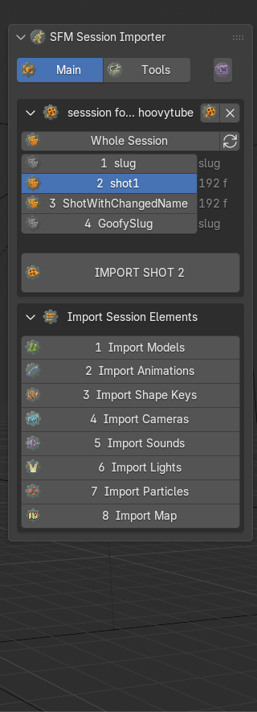
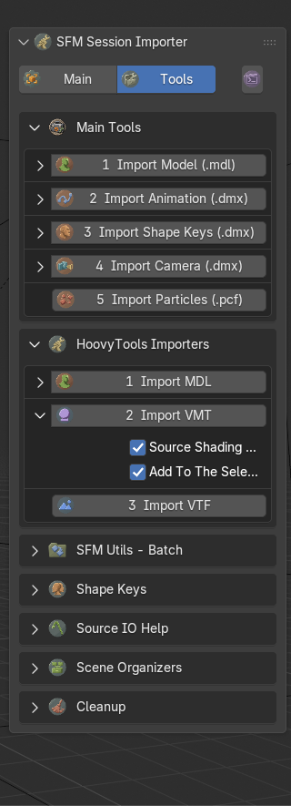
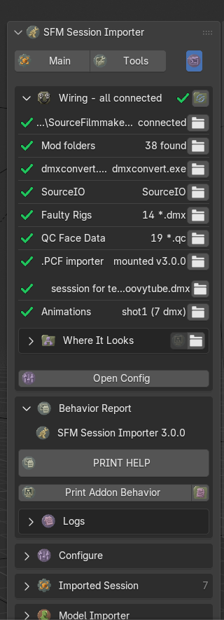

# SFM Session Importer
### the session half of HoovyTools - its twin, [Source Particle Import](https://github.com/hoovytubeofficial/HoovyTools-ParticleImport-Blender), brings the particles

Bring a Source Filmmaker session into Blender - the whole film or a single shot: models, animation, facial
animation, cameras, lights, sounds, particles and the map, on SFM's own timeline. The two add-ons share one sidebar
tab, and a session's particle effects come in through the twin.

*The add-on's own test session (shot 1), imported with one click and rendered in EEVEE.*

**Video tutorial:** [SFM Session to BLENDER Importer](https://www.youtube.com/watch?v=SGEVbgdZYaY) on SourceFilmmakerTube -
and for the twin, [Import Particles into Blender](https://www.youtube.com/watch?v=-NGdPxKTsJA).

**[Download 3.0.0](https://github.com/hoovytubeofficial/HoovyTools-SFMSessionImport-Blender/releases/download/v3.0.0/HoovyTools-SFMSessionImport-Blender-3.0.0.zip)** - then drag the zip onto Blender. ([All releases](https://github.com/hoovytubeofficial/HoovyTools-SFMSessionImport-Blender/releases))

Source Filmmaker saves a session as a DMX file and has assumed, since 2012, that nothing else will ever open it.
Valve has not given it much reason to reconsider. This add-on reads the file directly and rebuilds the shot in
Blender, frame for frame.

## What it does

- **Whole sessions or single shots.** Load a session `.dmx` and every shot is listed by name, slugs included. Pick
  one - or the whole film - and press IMPORT. Or run the eight elements one at a time, each with its own progress
  bar.
- **Models** come in through the add-on's own MDL reader: skins, bodygroups, eyes, materials. SourceIO is not
  needed for them.
- **Animation, facial animation and cameras** land on SFM's own frame numbers. Faces get the HWM flex bake; the
  flex rules are read straight out of each `.mdl`, so it works on whatever model the session uses.
- **Lights** become Blender spots, keyed where SFM keyed them, with an optional volumetric box.
- **Sounds** go onto the sequencer at the right frames. **Particles** come in through
  [Source Particle Import](https://github.com/hoovytubeofficial/HoovyTools-ParticleImport-Blender).
- **The map** comes in through SourceIO, in one collection, lined up with everything else. Without SourceIO the
  map is left out and the rest of the session imports anyway.
- **Standalone importers** for single files - MDL, VMT, VTF, animation and camera DMX, shape keys - for when there
  is no session to speak of.

<table>
<tr>
<td></td>
<td></td>
<td></td>
</tr>
<tr>
<td align="center">Main - the session and its shots</td>
<td align="center">Tools - single files</td>
<td align="center">Dev - wiring and reports</td>
</tr>
</table>

## Install

1. Download `HoovyTools-SFMSessionImport-Blender-3.0.0.zip` from [Releases](https://github.com/hoovytubeofficial/HoovyTools-SFMSessionImport-Blender/releases). Leave it zipped.
2. Drag the zip onto any Blender window. Blender offers to install a **Legacy Add-on** - keep *Enable on Install*
   ticked and press OK. (Edit > Preferences > Add-ons > Install from Disk does the same.)
3. In the 3D Viewport, open the sidebar (`N`) > **HoovyTools** > **SFM Session Importer**.

SFM is found in its default Steam folder. If yours lives elsewhere, the Dev tab's **Wiring** section has a LOAD
button for it, and Edit > Preferences has the same field.

**Requirements:** Blender 5.0 or newer and your own copy of Source Filmmaker.
**Optional:** [SourceIO](https://github.com/REDxEYE/SourceIO) for maps, and
[Source Particle Import](https://github.com/hoovytubeofficial/HoovyTools-ParticleImport-Blender) for particles.
The Wiring section says which of these it found.

## Quick start

1. **Main** tab > **LOAD DMX SESSION** and pick a session (the browser opens in `usermod/elements`).
2. Pick a shot in the list, or **Whole Session**.
3. Press **IMPORT SHOT n**. A bar at the bottom of the viewport says what it is working on.

A whole film imports every cut on top of each other, which is accurate and rarely what anybody wants. One shot at a
time is the sane default.

## Tutorial: printing a log report

When something goes wrong, one text file tells me what happened. This is how to make it.

1. Open the **Dev** tab - the small button at the right end of the tab row.
2. Unfold **Behavior Report**. The first line says which version you are on.
3. Press **PRINT HELP**. It writes `__SFM Session Importer Log Report Data__ (V1).txt` into the add-on's `_Logs`
   folder and opens that folder. Each press writes the next number (V2, V3...), so earlier reports are kept.
4. Send that file, with a sentence on what you did and what happened.

What is in it, top to bottom: what is wrong, in plain words; the Wiring check (what was found, and where); the
add-on's settings; the reports of the last imports; the console output; and the newest log file. If the checks find
nothing, the file says so - and still carries everything else, because "nothing found" and "nothing wrong" are not
the same thing.

> The report contains file paths from your computer, which include your Windows user name. Read it before posting
> it anywhere public.

Also in **Behavior Report**: **Print Addon Behavior** prints the add-on's state to the system console
(Window > Toggle System Console), the folder button opens `_Logs`, and **Logs** decides which reports are written.

## Tutorial: the standalone tools

The **Tools** tab works on single files, with or without a session loaded.

- **Main Tools** - 1 Import Model (`.mdl`), 2 Import Animation (`.dmx`), 3 Import Shape Keys (`.dmx`),
  4 Import Camera (`.dmx`), 5 Import Particles (`.pcf`, through Source Particle Import).
- **HoovyTools Importers** - Import MDL, Import VMT (a material; with a mesh selected it is added to it) and
  Import VTF (an image, sprite sheets included). None of them needs SourceIO.
- Below them: batch folders, shape-key repairs, rest poses and eyes, camera tools, and cleanup.

How a tool works:

1. Click the tool's name. A file browser opens in the matching `usermod` folder - `models`, `materials`, `elements`.
   Pick the same folder three times and it becomes that tool's starting folder.
2. The arrow on the left unfolds the tool's options. They are exactly what the next press will use.

Import VMT and Import VTF also come as a **Text Editor version** - a plain script that does the same job, for batch
work or for reading how it is done:

1. **Dev** tab > **DEVELOPER MODE** (the last button).
2. A folder button appears next to Import VMT and Import VTF. It opens `# tools/Import VMT/`.
3. In Blender's Text Editor, Text > Open > `Import VMT (V1).py`.
4. Fill in the line at the top - `VMT_FILES = [r"C:\path\to\material.vmt"]` - and press **Run Script** (`Alt+P`).

## Version history

- **3.0.0** - this release: the session's shots by name, the map step, the add-on's own MDL / VMT / VTF importers,
  progress bars on every step, a Dev tab with Wiring, PRINT HELP and Configure.
- **2.0.0** - the version that was on [hoovytube.com](https://hoovytube.com), published there as HoovyTools 1.3.1.
  Kept on [Releases](https://github.com/hoovytubeofficial/HoovyTools-SFMSessionImport-Blender/releases/tag/v2.0.0) for reference. Install one version at a time - they share
  their buttons and do not enjoy being enabled together.

## What is in the box

Code, plus two small data folders: `_QC Face Data` holds the flex rules of twelve TF2 / HL2 characters as text, and
`_Faulty Rigs` the rest-pose corrections for a few models that need them. Models, textures, maps and sessions come
from your own SFM install.

## Credits

Made by **HoovyTube** - [Patreon](https://www.patreon.com/HoovyTube) - [Website](https://hoovytube.com) -
[GitHub](https://github.com/hoovytubeofficial/HoovyTools-SFMSessionImport-Blender), the source of truth for new
versions.

Built on [Blender Source Tools](https://github.com/Artfunkel/BlenderSourceTools) by Artfunkel (Tom Edwards), with
lasa01 and suXinjke - the DMX reader underneath everything here - and on [SourceIO](https://github.com/REDxEYE/SourceIO)
by REDxEYE.

## License

Free for everyone. The add-on's own code is MIT; it bundles part of Blender Source Tools (GPL v2 or later), so a copy
shared with it is GPL as a whole. See [LICENSE.txt](LICENSE.txt).

Valve, Source, Source Filmmaker and SFM are trademarks of Valve Corporation. This add-on is not made by or
affiliated with Valve.
